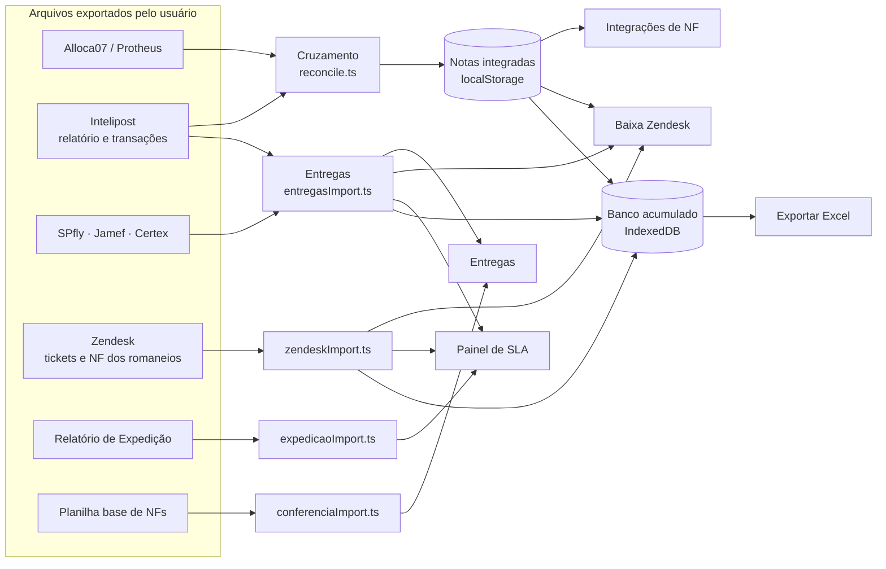

# ArkTransp — Documentação técnica

> Ferramenta interna da Arklok (Operações / Logística) para cruzar notas fiscais entre sistemas, acompanhar entregas
> das transportadoras, medir SLA e apoiar a baixa de tickets no Zendesk.
>
> Responsável: Diogo Silva · Versão do documento: outubro/2026

---

## 1. Resumo

O ArkTransp substitui o trabalho manual de cruzar planilhas no Excel. O usuário exporta relatórios dos sistemas que já
usa (Alloca07/Protheus, Intelipost, portais das transportadoras e Zendesk), arrasta os arquivos para o app e ele:

| O que faz | Tela |
|---|---|
| Cruza as NFs da Alloca07 com as da Intelipost e mostra o que integrou, o que não integrou e o que só existe na Intelipost | **Integrações de NF** |
| Cruza uma planilha base de NFs com as planilhas de entrega e diz o que já foi entregue | **Entregas** |
| Mostra quais tickets do Zendesk já têm todas as NFs entregues e podem ser fechados (gera a planilha de baixa em massa) | **Baixa Zendesk** |
| Mede o SLA das transportadoras (entrega × previsão), por região, e lista os tickets em atraso | **Painel** |
| Guarda um histórico acumulado por mês e permite exportar tudo em Excel | **Banco de dados** (botão no topo) |

**Pontos importantes para a TI:**

- **Não há servidor nem banco de dados externo.** É um site estático (HTML + JavaScript) que roda inteiro no
  navegador. As planilhas são lidas no próprio navegador e os dados ficam guardados no navegador da máquina do usuário.
- **Não faz nenhuma chamada para a internet.** Não há API, telemetria, fontes ou scripts de CDN. Uma política de
  segurança (CSP) bloqueia qualquer conexão fora do próprio endereço do app.
- **Não integra com os sistemas de origem.** Toda entrada é por arquivo exportado manualmente (.xlsx, .xls, .csv).

---

## 2. Tecnologia

| Item | Uso |
|---|---|
| **React 19 + TypeScript** | Interface |
| **Vite 6** | Servidor de desenvolvimento e build |
| **SheetJS (`xlsx` 0.20.3)** | Leitura e geração de planilhas Excel/CSV no navegador |
| **CSS puro** (`src/styles.css`) | Visual no padrão de identidade Arklok 2024 (tema claro e escuro) |
| **localStorage / IndexedDB** | Armazenamento local no navegador |

Não há outras dependências de runtime além de `react`, `react-dom` e `xlsx`.

### Como rodar

Pré-requisito: Node.js 20 ou superior.

```bash
npm install          # instala as dependências (única etapa que acessa a internet)
npm run dev          # servidor local em http://localhost:5173
npm run build        # gera a versão estática em dist/
npm run preview      # serve a pasta dist/ localmente
```

O servidor de desenvolvimento escuta só em `localhost`, ou seja, não fica acessível para outras máquinas da rede.

A pasta `dist/` gerada pelo build pode ser publicada em qualquer hospedagem de site estático (IIS, Nginx, Vercel,
SharePoint etc.). Mesmo publicado, os dados continuam ficando no navegador de cada usuário.

---

## 3. Segurança e privacidade

- **Content-Security-Policy** (definida em `vite.config.ts`): `default-src 'self'`, `connect-src 'self'`,
  `form-action 'none'`, `object-src 'none'`. O navegador só carrega recursos e abre conexões no próprio endereço do app.
- **`referrer: no-referrer`** no `index.html`.
- **Sem autenticação.** O app não tem login porque não há dados no servidor; quem tem acesso à máquina/navegador
  tem acesso aos dados.
- **Dados sensíveis tratados:** número de NF, nome de cliente/destinatário, cidade/UF, número de ticket, recebedor
  da entrega. Nada disso sai da máquina, exceto quando o próprio usuário exporta uma planilha.
- **Exportação para pasta:** usa a File System Access API do Chrome/Edge. O usuário escolhe a pasta uma vez e o
  navegador guarda a permissão.

---

## 4. Fluxo de dados



Cada importador:

1. lê o arquivo com SheetJS;
2. encontra a aba e a linha de cabeçalho pelos nomes das colunas (normalizados: minúsculas, sem acento);
3. converte para objetos tipados;
4. grava no armazenamento local e avisa as telas, que se atualizam sozinhas.

---

## 5. Fontes de dados (planilhas aceitas)

| Planilha | De onde vem | Formato | Como o app reconhece | Onde é enviada |
|---|---|---|---|---|
| **Alloca07** | Protheus (relatório Alloca07, aba "Listagem do Browse") | .xlsx/.csv | Colunas `Tp. Previsão`, `Nome Dest.`, `Dt. Emissão`, `Romaneio` | Integrações de NF |
| **Intelipost (relatório de envios)** | Portal Intelipost | .xlsx/.csv | Colunas `Transportadora`, `Status transportador`, `Código de rastreio`, `Nome do destinatário` | Integrações de NF |
| **Transações Intelipost** | Portal Intelipost (`transactions_*.xlsx`) | .xlsx | Status de entrega de todas as transportadoras | Entregas |
| **SPfly** | Portal SPfly (`Relatorio_Entrega_*.csv`) | .csv | `Nota Fiscal`, `Cidade/Estado destino`, `Prev. entrega`, `Data de entrega` | Entregas |
| **Certex** | Portal Certex (`Relatorio_Entrega_*.csv`) | .csv | idem SPfly | Entregas |
| **Jamef** | Portal Jamef (`JCENTREGA_*.xlsx`) — só exporta 30 dias por vez | .xlsx | idem | Entregas (aceita vários arquivos, que são somados) |
| **Planilha base** | Qualquer planilha com coluna de NF (ex.: Alloca08, "Exportar todos" da Baixa Zendesk) | .xlsx/.csv | Coluna `Nota Fiscal`/`NF`; opcionais: ticket, `Tp. Previsão`, `Dt. Emissão`, `Mun./UF Destino` | Entregas |
| **Tickets Zendesk** | Explore → relatório "Aging" (inglês ou português) | .xlsx | `Ticket ID`/`ID do ticket`, status personalizado | Baixa Zendesk |
| **NF dos romaneios** | Planilha interna (aba `Base_Dados`) | .xlsx | Chamado, romaneio, NF, etapa | Baixa Zendesk |
| **Relatório de Expedição** | Base de expedição (CSV ~20 mil linhas) | .csv/.xlsx | NF, data/hora de saída, UF, transportadora | Painel |

**Regras gerais de leitura**

- Datas aceitas: número de série do Excel, `dd/mm/aaaa`, `d/m/aa` e `aaaa-mm-dd`.
- NF é comparada como número, sem zeros à esquerda (`000235084` = `235084`).
- Nas planilhas de transportadora, **reversas** e **retornos ao CD de Itapevi** (destinatário Arklok em Itapevi)
  são descartados, porque não são entregas ao cliente.
- Nas transações da Intelipost, envios **cancelados** não contam como entrega nem como rota.

---

## 6. Telas e regras de negócio

### 6.1 Início (`#/dashboard`)

Checklist das planilhas do dia (o que foi enviado e quando), prioridades e resumo de entregas por transportadora.

### 6.2 Integrações de NF (`#/integrations`)

Cruzamento **Alloca07 × Intelipost** (`src/reconcile.ts`):

| Situação | Regra |
|---|---|
| **Integrada** | A NF da Alloca07 existe na Intelipost (validação **direta**) ou a **NF triangular** dela existe (validação **triangular**) |
| **Não integrada** | Nem a NF nem a triangular estão na Intelipost |
| **Só Intelipost** | NF da Intelipost que não é principal nem triangular de nenhuma nota da Alloca07 |
| Fora do cruzamento | Notas do tipo **REMANEJAMENTO FISCAL**, e notas emitidas (ou criadas na Intelipost) no **dia útil corrente**, que ainda não tiveram tempo de integrar |

Filtros: status, tipo da nota, mês e período de emissão, tratativa, ticket Zendesk, "só anormais" (data de emissão
diferente da data de integração).

**Tratativa:** cada nota pode receber comentários, PDV, nota antiga/nova e ser marcada como tratada.

### 6.3 Baixa Zendesk (`#/zendesk`)

- Só ficam os tickets com status **"Em rota de entrega"** ou **"Aguardando expedição"**.
- Cada ticket é ligado às NFs do romaneio (planilha de NF dos romaneios).
- **Pronto para baixa** = todas as linhas do romaneio têm NF **e** todas essas NFs constam como entregues.
- Gera a planilha **baixaMassa** (aba `Tickets`, coluna `id_zendesk`) no modelo de baixa em massa do Zendesk.

### 6.4 Entregas (`#/entregas`)

Cruza a **planilha base** com as planilhas de entrega.

- As transações da Intelipost e as planilhas das transportadoras **valem juntas**. Se as duas fontes têm a NF, vale
  a situação mais avançada: entregue > entregue no mesmo dia > devolvida > em trânsito > sem rastreio. O recebedor
  vem da planilha da transportadora.
- **Frota interna** e **Lalamove** contam como entregues quando o status é de entrega.
- Resultado por linha: Todas entregues · Parte entregue · Não entregues · Frota/Lalamove · Não encontradas.
- Filtros: tipo, região, situação de SLA, mês/período de emissão, busca por NF ou ticket.
- Quadro **% no prazo por região** e coluna de SLA por NF (mesma regra do Painel, ver 6.5).
- Ações: copiar NFs, baixa em massa (se houver ticket), exportar Excel.

### 6.5 Painel de SLA (`#/painel`)

- **SLA = data de entrega × previsão de entrega informada pela transportadora**, contado em **dias úteis**
  (segunda a sexta; feriados não são considerados).

| Situação | Regra |
|---|---|
| Entregue no prazo | Entrega ≤ previsão |
| Entregue com atraso | Entrega > previsão (mostra dias úteis de atraso) |
| Vencida sem entrega | Sem entrega e previsão já passou |
| Em trânsito no prazo | Sem entrega e previsão ainda não chegou |
| Devolução | Último status contém "devolução" |
| Sem previsão | Transportadora não informou previsão |

- **% dentro do SLA** = no prazo ÷ (no prazo + com atraso + vencidas). Meta: **95%** (verde ≥ 95%, amarelo ≥ 85%,
  vermelho abaixo).
- **Região** = região do IBGE pela **UF de destino** (Sudeste, Sul, Centro-Oeste, Nordeste, Norte).
- **Lead time** = dias úteis entre a saída da Arklok (Relatório de Expedição) e a entrega.
- **Tickets em atraso sem entrega:** NFs vencidas ligadas a tickets abertos do Zendesk.
- Fonte: planilhas da SPfly, Jamef e Certex (são as que trazem previsão). Destinos Arklok (retornos) ficam fora.

### 6.6 Outras telas

| Tela | Conteúdo |
|---|---|
| **Compasse** (`#/compasse`) | Em construção |
| **Relatórios** (`#/reports`) | Download de listas em CSV |
| **Configurações** (`#/settings`) | Tema claro/escuro e explicação de cada situação ("Como funciona") |
| **Busca global** (topo) | Procura NF ou ticket em todas as bases |
| **Seletor de dia** (topo) | "Hoje" (dados vivos) ou um dia salvo (somente leitura) |
| **Banco de dados** (topo) | Exporta um mês, o banco completo ou os dados carregados agora |

---

## 7. Estrutura de dados

### 7.1 Principais tipos (TypeScript)

**Nota do cruzamento** — `Integration` (`src/types/index.ts`)

| Campo | Descrição |
|---|---|
| `id` | `NF-<número>` |
| `status` | `completed` (integrada), `pending` (não integrada), `intelipost_only` |
| `metadata.notaFiscal` / `nfTriangular` | Números da NF principal e triangular |
| `metadata.validacao` | `direta` ou `triangular` |
| `metadata.tipoNota` | "Tp. Previsão" da Alloca07 (Sustentação, Substituição, Projetos…) |
| `metadata.dataEmissao` / `dataIntegracao` | `aaaa-mm-dd` / data de criação na Intelipost |
| `metadata.clienteDestino`, `cidade`, `uf`, `romaneio`, `pedido`, `contrato` | Dados da Alloca07 |
| `metadata.transportadora`, `rastreio` | Dados da Intelipost |

**Evento de entrega** — `EventoTransportadora` (`src/services/entregasImport.ts`)

| Campo | Descrição |
|---|---|
| `ultimoStatus`, `dataStatus` | Último status informado |
| `previsao`, `dataEntrega` | Previsão e data efetiva de entrega |
| `recebedor`, `destinatario`, `cidade`, `uf` | Destino |
| `transportadora`, `base` | Só nas transações da Intelipost |

Cada planilha de entrega vira `porNf: Record<NF, EventoTransportadora[]>` (uma NF pode ter vários eventos).

**Situação de entrega de uma NF** — `EntregaNf`: `situacao` (`entregue`, `mesmo_dia`, `devolvida`, `em_transito`,
`sem_rastreio`), `transportadora`, `evento`, `modal` (`frota` / `lalamove`).

**Linha da planilha base** — `LinhaConferencia` (`src/services/conferenciaImport.ts`): `ticket`, `nfs[]`,
`organizacao`, `tipo`, `emissao`, `cidade`, `uf`.

**Ticket Zendesk** — `ZendeskTicket` + `NfImport.porTicket: Record<ticket, { romaneio, dataRomaneio, nf, etapa }[]>`.

**Nota de SLA** — `NotaSla` (`src/services/sla.ts`): NF, transportadora, região, previsão, entrega, `status`,
`atraso` (dias úteis), `leadTime`.

### 7.2 Onde os dados ficam guardados

Tudo fica **no navegador** do usuário (por perfil do Chrome/Edge e por endereço do site). Limpar os dados do site
apaga tudo.

**localStorage** (limite ~5–10 MB por site)

| Chave | Conteúdo |
|---|---|
| `arklok_integrations_v3` | Notas do cruzamento Alloca07 × Intelipost |
| `arklok_reconcile_revision`, `arklok_cruzamento_info_v1` | Versão da base e arquivos/horário do último envio |
| `arklok_tratativas_v1` | Comentários e tratativas por nota |
| `arklok_entregas_base_v1` | Planilha base da tela Entregas |
| `arklok_entregas_transacoes_v1` | Transações da Intelipost |
| `arklok_entregas_spfly_v1`, `_jamef_v1`, `_certex_v1` | Planilhas das transportadoras |
| `arklok_entregas_rota_v1` | Planilha de rota (legado) |
| `arklok_zendesk_tickets_v1`, `arklok_zendesk_nf_v1` | Tickets e NF dos romaneios |
| `arklok_importacoes_v1` | Histórico das importações (até 300 registros) |
| `arklok_theme`, `arklok_sidebar_collapsed`, `arklok_menu_abertos`, `arklok_periodo_emissao` | Preferências de tela |
| `arklok_executions_v1`, `arklok_logs_v1` | Restos do modelo inicial (dados de exemplo) |

**IndexedDB** (sem limite prático; usado para volumes grandes)

| Banco | Stores | Conteúdo |
|---|---|---|
| `arklok_banco` | `base` (índice `mes`), `tabelas`, `dias`, `snapshots` | **Banco acumulado**: uma linha por NF/ticket, atualizada a cada importação, separada pelo mês de emissão; resumo diário e fotos completas de dias antigos |
| `arklok_expedicao` | `atual` | Relatório de Expedição (~20 mil linhas) |
| `arklok_pastas` | `exportGeral` | Permissão da pasta escolhida para exportações |

**Exportar geral / banco** gera um Excel com as abas `Notas`, `Tratativas`, `Zendesk_Tickets`, `Zendesk_NF`,
`Entregas` e `Transportadoras`.

---

## 8. Organização do código

```
src/
├── main.tsx, App.tsx          Entrada e roteamento (hash: #/rota)
├── parse.ts                   Leitura genérica de planilhas e detecção Alloca07/Intelipost
├── reconcile.ts               Regras do cruzamento Alloca07 × Intelipost
├── context/AppContext.tsx     Estado global (notas, filtros, tema, toasts)
├── router/useRouter.ts        Roteador por hash e breadcrumbs
├── services/
│   ├── workbookImport.ts      Importação Alloca07 + Intelipost → notas
│   ├── integrationService.ts  Persistência e métricas das notas
│   ├── entregasImport.ts      Transações Intelipost, SPfly, Jamef, Certex e regras de entrega
│   ├── conferenciaImport.ts   Planilha base da tela Entregas
│   ├── zendeskImport.ts       Tickets e NF dos romaneios
│   ├── expedicaoImport.ts     Relatório de Expedição (IndexedDB)
│   ├── sla.ts                 Cálculo de SLA, regiões e dias úteis
│   ├── bancoDiario.ts         Banco acumulado e histórico diário (IndexedDB)
│   ├── exportGeral.ts, pastaExport.ts, baixaMassa.ts   Exportações
│   ├── importacoes.ts         Prévia e histórico de importações
│   └── tratativaService.ts    Tratativas por nota
├── hooks/                     Cruzamentos usados pelas telas (entrega por ticket, tickets por NF, conferência)
├── pages/                     Uma página por tela
├── components/                Layout (menu, topo, busca, seletor de dia), gráficos e componentes comuns
└── utils/                     Dias úteis, períodos, CSV, anomalias
```

---

## 9. Limitações e pontos de atenção

1. **Dados por máquina e por navegador.** Não há compartilhamento entre usuários; outro computador começa vazio.
   Backup = botão **Banco de dados → exportar**.
2. **Limite do localStorage.** Planilhas muito grandes podem não caber; o app avisa ("carregada só nesta sessão").
3. **Feriados não entram** no cálculo de dias úteis (só sábado e domingo).
4. **NF repetida entre emitentes.** O número da NF pode se repetir entre empresas diferentes; quando possível o app
   confere a UF de destino.
5. **SLA usa a previsão da transportadora**, não uma tabela de prazos contratados da Arklok.
6. **Entrada manual.** Depende de o usuário exportar as planilhas certas; mudanças de layout nos portais (nomes de
   colunas) exigem ajuste no importador.
7. **Compasse** ainda está em construção.
8. Há 3 erros de tipagem conhecidos em `src/services/importacoes.ts` (linhas 182, 305 e 306) que não afetam o uso em
   desenvolvimento, mas fazem o `npm run build` (que roda `tsc`) falhar até serem corrigidos.

---

## 10. Possíveis evoluções

- Tabela de prazos de SLA por região/transportadora mantida pela Arklok.
- Calendário de feriados no cálculo de dias úteis.
- Backend leve (ou SharePoint/Banco corporativo) para compartilhar a base entre a equipe.
- Integração direta via API com Intelipost e Zendesk, eliminando a exportação manual.
- Conteúdo da tela Compasse.
