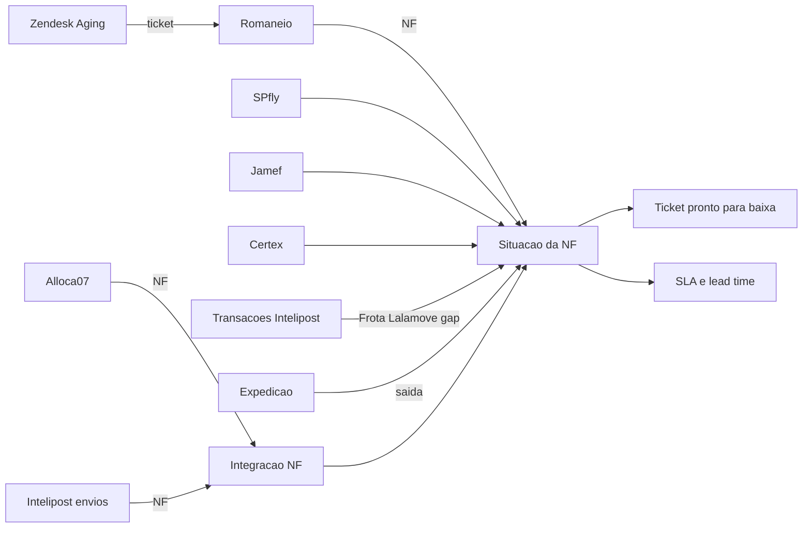

# ArkTransp — resumo do sistema para criar novos fronts e KPIs

> Base para desenhar telas novas, painéis e indicadores personalizados em cima do que o ArkTransp já lê e calcula.
> Detalhes de implementação ficam em `DOCUMENTACAO_TECNICA.md`.

---

## 1. O que é

O ArkTransp é a ferramenta da logística da Arklok para acompanhar o caminho de uma nota fiscal desde a emissão até a
entrega ao cliente e o fechamento do ticket no Zendesk. Ele responde, todo dia:

- A NF emitida na Alloca07 chegou na Intelipost? (integração)
- A transportadora já entregou? Quando, para quem, dentro do prazo? (entrega e SLA)
- O ticket do Zendesk já pode ser fechado? (baixa)

**Como funciona por dentro**

- Roda inteiro no navegador. Não tem servidor, banco externo, login nem API.
- Toda entrada é por **planilha exportada** dos sistemas e arrastada para o app.
- Os dados ficam no próprio navegador (localStorage e IndexedDB). Cada máquina tem sua própria base.
- Stack: React 19 + TypeScript + Vite + SheetJS. CSS próprio, tema claro e escuro, identidade Arklok.

Qualquer front novo pode ser feito como **mais uma tela dentro do app**, reaproveitando os mesmos dados já carregados
(seção 6). Não é preciso reimportar nada.

---

## 2. Fontes de dados

| # | Planilha | Origem | Para que serve | Campos principais |
|---|---|---|---|---|
| 1 | **Zendesk Aging** | Zendesk Explore | Tickets abertos | ID do ticket, status (Em rota de entrega / Aguardando expedição), grupo, organização (nome + CNPJ), grupo econômico, UF, localidade, prioridade, criado em, atualizado em, idade (dias), dias sem atualização |
| 2 | **Romaneio (Base_Dados)** | Planilha interna | Liga ticket ↔ NF | Chamado, romaneio, data do romaneio, NF, etapa atual |
| 3 | **SPfly** `Relatorio_Entrega` | Portal SPfly | Confirma entrega | NF, CT-e, data CT-e, destinatário, cidade/UF, pedido, previsão, volume, pesos, frete, modal, tipo de serviço, **recebedor**, **data de entrega** |
| 4 | **Jamef** `JCENTREGA` | Portal Jamef (30 dias por arquivo, soma vários) | Confirma entrega | NF, CT-e, CNPJ/nome destinatário, município/UF, CEP, peso, cubagem, volumes, valores, previsão, data de realização, status, ocorrências |
| 5 | **Certex** `Relatorio_Entrega` | Portal Certex | Confirma entrega | Mesmo layout da SPfly |
| 6 | **Transações Intelipost** | Portal Intelipost | Complemento: Frota interna, Lalamove e NFs fora das planilhas 3–5 | NF, transportadora, rastreio, status, data despacho, data entrega, previsão (cliente e transportadora), performance, frete (custo/preço), volumes, peso, cubagem, hub/base, ocorrências |
| 7 | **Alloca07** | Protheus | Notas emitidas | NF, NF triangular, tipo (Tp. Previsão), data de emissão, cliente, cidade/UF, romaneio, pedido, contrato |
| 8 | **Intelipost (envios)** | Portal Intelipost | Cruzamento com a Alloca07 | NF, transportadora, status, rastreio, destinatário |
| 9 | **Relatório de Expedição** | Base da expedição (~20 mil linhas) | Data/hora de saída da Arklok (lead time) | NF, saída, UF, transportadora, modal, tipo, cliente |
| 10 | **Planilha base** (opcional) | Qualquer planilha com coluna de NF | Conferir uma lista específica | NF, ticket, tipo, emissão, cidade/UF |

**Chaves de ligação**

- **NF**: número sem zeros à esquerda (`000235084` = `235084`). Liga Alloca07, Intelipost, transportadoras e expedição.
- **NF triangular**: a mesma carga com outra NF; se a principal não aparecer, vale a triangular.
- **Ticket**: número do Zendesk. Liga o Aging ao romaneio. **As transportadoras não conhecem o ticket**: a ponte é
  sempre ticket → romaneio → NF.

---

## 3. Regras de negócio (o que cada status significa)

### Integração (Alloca07 × Intelipost)

| Status | Regra |
|---|---|
| Integrada | NF (ou a triangular) da Alloca07 existe na Intelipost |
| Não integrada | Nem a NF nem a triangular estão na Intelipost |
| Só Intelipost | Está na Intelipost e não corresponde a nenhuma NF da Alloca07 |
| Fora do cruzamento | Remanejamento fiscal e notas do dia útil corrente |

### Entrega de uma NF

- **Entregue** = tem **data de entrega na planilha da transportadora** (SPfly, Jamef, Certex). Essa fonte manda.
- A Intelipost **não promove** a entregue uma NF que está na planilha da transportadora sem data.
- Transações Intelipost só valem para **Frota interna**, **Lalamove** e NFs que não aparecem nas planilhas 3–5.
- Situações possíveis: `entregue`, `mesmo_dia`, `devolvida`, `em_transito`, `sem_rastreio`.
- Reversas e retornos ao CD de Itapevi são descartados. Envios cancelados não contam.

### Ticket do Zendesk

| Situação do romaneio | Regra |
|---|---|
| Com NF | Todas as linhas do romaneio do ticket têm NF |
| Sem NF | Alguma linha do romaneio ainda está sem NF |
| Fora da planilha | O número do ticket não aparece no romaneio |

- **Pronto para baixa** = pelo menos uma NF entregue (a triangular vale pela remessa), todas as linhas do romaneio com NF **e** nenhuma NF da Lalamove.
- **Frota interna conta como entregue** assim que tem envio ativo nas Transações (entrega no mesmo dia) e entra em Já entregues — dar baixa.
- Frota interna e Lalamove continuam com abas próprias para consulta. A baixa em massa sempre exporta os tickets da aba aberta.

### SLA

- **SLA = data de entrega × previsão da transportadora**, em **dias úteis** (seg–sex, sem feriados).
- Status: no prazo · com atraso · vencida sem entrega · em trânsito no prazo · devolução · sem previsão.
- **% dentro do SLA** = no prazo ÷ (no prazo + com atraso + vencidas). Meta **95%** (verde ≥ 95, amarelo ≥ 85).
- **Região** = região do IBGE pela UF de destino.
- **Lead time** = dias úteis entre a saída da Arklok (Expedição) e a entrega.

---

## 4. Telas que já existem

| Tela | Rota | Mostra hoje |
|---|---|---|
| Início | `#/dashboard` | Checklist das planilhas do dia, tarefas prioritárias, entregas por transportadora |
| Integrações de NF | `#/integrations` | Integradas / não integradas / só Intelipost, tratativas por nota |
| Baixa Zendesk | `#/zendesk` | 6 importações, abas Em rota, Aguardando, Já entregues, Frota, Lalamove; copiar NFs/tickets, baixa em massa |
| Entregas | `#/entregas` | Conferência de uma lista de NFs, % no prazo por região, comparar Intelipost × SPfly |
| Painel de SLA | `#/painel` | % dentro do SLA, no prazo, com atraso, vencidas, lead time, por região e transportadora |
| Relatórios | `#/reports` | Downloads em CSV |
| Banco de dados | botão no topo | Histórico acumulado por mês e por dia, exportação completa |

**KPIs já calculados**

- Painel: Dentro do SLA (%), Notas monitoradas, Entregues no prazo, Entregues com atraso (+ atraso médio), Vencidas
  sem entrega, Lead time médio.
- Início/menu: tickets prontos para baixa, entregas atrasadas, notas não integradas, só Intelipost, tickets com
  romaneio sem NF.
- Integrações: total, integradas, não integradas, só Intelipost, taxa de sucesso.

---

## 5. Catálogo de KPIs possíveis com os dados atuais

Todos saem das planilhas que já são importadas. A coluna "Fontes" indica o que precisa estar carregado.

### Entrega e transportadora

| KPI | Cálculo | Fontes |
|---|---|---|
| % dentro do SLA por transportadora | no prazo ÷ avaliadas, por SPfly/Jamef/Certex | 3, 4, 5 |
| % dentro do SLA por região / UF / cidade | mesmo cálculo agrupado pelo destino | 3, 4, 5 |
| Atraso médio e máximo (dias úteis) | média/máximo de `atraso` das entregues com atraso | 3, 4, 5 |
| Vencidas sem entrega por faixa de atraso | 1–2, 3–5, 6–10, >10 dias úteis | 3, 4, 5 |
| Lead time médio por transportadora / região | saída da Expedição → entrega | 3, 4, 5, 9 |
| Ranking de transportadoras | % SLA, atraso médio, vencidas, volume | 3, 4, 5 |
| Gap Intelipost | entregues na transportadora e ainda Em trânsito/Despachado na Intelipost | 3, 4, 5, 6 |
| Despachadas sem rastreio | status Despachado sem ocorrência na Intelipost | 6 |
| Devoluções | quantidade e % das NFs com status de devolução | 3, 4, 5, 6 |
| Frota interna e Lalamove | volume, entregues, pendentes | 6 |
| Custo de frete | soma/média de frete por transportadora, região, tipo de serviço; frete por kg | 3, 5, 6 |
| Peso e volumes despachados | por dia, transportadora, região | 3, 4, 6 |
| Entregas por dia | contagem pela data de entrega (curva diária/semanal) | 3, 4, 5 |
| Top recebedores / clientes com atraso | agrupado por destinatário | 3, 4, 5 |

### Zendesk e baixa

| KPI | Cálculo | Fontes |
|---|---|---|
| Tickets prontos para baixa | pelo menos uma NF entregue (Frota interna conta), sem Lalamove | 1, 2, 3–6 |
| Tickets por situação do romaneio | com NF / sem NF / fora da planilha | 1, 2 |
| Idade média dos tickets abertos | por status, grupo, organização, UF | 1 |
| Tickets parados | dias sem atualização acima de N | 1 |
| Tickets em atraso sem entrega | NFs vencidas ligadas a tickets abertos | 1, 2, 3–5 |
| Tempo entregue → ticket aberto | dias desde a entrega com o ticket ainda aberto (baixa represada) | 1, 2, 3–5 |
| Tickets por cliente / grupo econômico | contagem e idade média | 1 |
| Cobertura do romaneio | % de tickets que aparecem no romaneio; % de linhas do romaneio sem chamado | 1, 2 |

### Integração fiscal

| KPI | Cálculo | Fontes |
|---|---|---|
| Taxa de integração | integradas ÷ total | 7, 8 |
| Não integradas por tipo de nota | Sustentação, Substituição, Projetos… | 7, 8 |
| Integração triangular | % integradas pela NF triangular | 7, 8 |
| Atraso de integração | emissão × criação na Intelipost (notas "anormais") | 7, 8 |
| Pendências tratadas | notas com tratativa concluída ÷ não integradas | 7, 8 + tratativas |

### Evolução no tempo (banco acumulado)

| KPI | Cálculo | Fontes |
|---|---|---|
| Tendência diária | contagens por dia salvas no banco (resumo diário) | Banco de dados |
| Comparativo mês a mês | notas e situação de entrega por mês de emissão | Banco de dados |

---

## 6. De onde tirar os dados numa tela nova

Todos os hooks já reagem sozinhos quando uma planilha é trocada.

| Hook / função | Arquivo | Devolve |
|---|---|---|
| `useApp()` | `src/context/AppContext.tsx` | Notas do cruzamento (`integrations`), `metrics`, filtros globais (período de emissão), tema, `addToast` |
| `useEntregas()` | `src/services/entregasImport.ts` | Planilhas SPfly/Jamef/Certex (`transportadoras[id].porNf`) e Transações (`transacoes.porNf`) |
| `useEntregasNotas()` | `src/hooks/useEntregasNotas.ts` | Cada nota integrada com situação de entrega, transportadora, modal e tickets ligados |
| `useZendesk()` | `src/services/zendeskImport.ts` | Tickets do Aging e romaneio (`nf.porTicket`) |
| `resumoNf(nf, ticket)` | `src/services/zendeskImport.ts` | Com NF / sem NF / fora da planilha de um ticket |
| `useEntregaPorTicket()` | `src/hooks/useEntregaPorTicket.ts` | Por ticket: NFs, entregues, Frota/Lalamove, `completa` (pronto para baixa) |
| `useTicketsPorNf()` | `src/hooks/useTicketsPorNf.ts` | Mapa NF → tickets |
| `useSla()` / `calcularSla()` | `src/services/sla.ts` | Lista `NotaSla` (status, atraso, lead time, região) e retornos à Arklok |
| `regiaoDe(uf)` | `src/services/sla.ts` | Região do IBGE |
| `useExpedicao()` | `src/services/expedicaoImport.ts` | Saída de cada NF da Arklok |
| `useConferencia()` | `src/hooks/useConferencia.ts` | Planilha base cruzada com as entregas |
| `useTratativas()` | `src/services/tratativaService.ts` | Comentários e tratativas por nota |
| `useDiaAtivo()` | `src/services/diaAtivo.ts` | Dia aberto (hoje ou um dia salvo, somente leitura) |

**Componentes reaproveitáveis**: cartões de KPI e gráficos do Painel (`bi-kpi`, cards), `UploadCard`,
`EstadoVazio`, tabelas `data-table`, abas `detail-tabs-bar`, badges `status-badge` (success, warning, danger, info).

**Exportação**: `exportarBaixaMassa(ids, nome)` (modelo Zendesk) e SheetJS para qualquer Excel novo.

---

## 7. Identidade visual

| Item | Valor |
|---|---|
| Cor da marca | Vermelho Arklok `#da291c` (`--arklok-red`) |
| Sucesso | `#2a7221` claro · `#4fae3f` escuro |
| Atenção | `#8a6500` claro · `#fec601` escuro |
| Perigo | `#c0241a` claro · `#ff5a4d` escuro |
| Neutro/info | `#4d5459` claro · `#a7b1b7` escuro |
| Temas | claro e escuro (padrão escuro), via `data-theme` no `<html>` |
| Faixas de SLA | verde ≥ 95%, amarelo ≥ 85%, vermelho abaixo |

Use sempre as variáveis CSS (`var(--...)`) para os dois temas funcionarem.

---

## 8. Limites para levar em conta no desenho

1. **Dados por navegador**: cada máquina tem sua base; não há visão compartilhada da equipe.
2. **Entrada manual**: o KPI só é tão atual quanto a última planilha enviada. Vale mostrar a data/hora de cada fonte.
3. **Romaneio incompleto**: muitas linhas vêm sem o número do chamado, então parte dos tickets cai em "Fora da
   planilha" mesmo tendo NF.
4. **Sem ticket nas transportadoras**: KPIs de ticket dependem do romaneio para chegar à NF.
5. **Feriados não entram** nos dias úteis.
6. **SLA usa a previsão da transportadora**, não um prazo contratado pela Arklok.
7. **Jamef** exporta no máximo 30 dias por arquivo (o app soma vários).
8. **Espaço**: as planilhas de transportadora, Zendesk e Transações ainda ficam no localStorage (~5 MB no total);
   a base do cruzamento e a Expedição já estão no IndexedDB.

---

## 9. Ideias de fronts

| Front | Público | Conteúdo sugerido |
|---|---|---|
| Painel executivo | Gestão | % SLA geral e por transportadora, tendência mensal, custo de frete, vencidas, ranking |
| Torre de controle diária | Operação | Planilhas do dia, vencidas sem entrega, gap Intelipost, despachadas sem rastreio, baixas pendentes |
| Visão por transportadora | Gestão de transportes | SLA, atraso, devoluções, custo e volume de uma transportadora, com lista de NFs |
| Visão por cliente | Atendimento / CS | Tickets abertos, entregas e atrasos de um cliente ou grupo econômico |
| Fila de baixa | Atendimento Zendesk | Prontos para baixa, Frota, Lalamove, sem NF, fora da planilha, com ações em massa |
| Mapa por UF/região | Gestão | % SLA e volume por estado |
| Saúde dos dados | Quem importa as planilhas | Idade de cada fonte, % do romaneio sem chamado, NFs sem rastreio, espaço do navegador |
